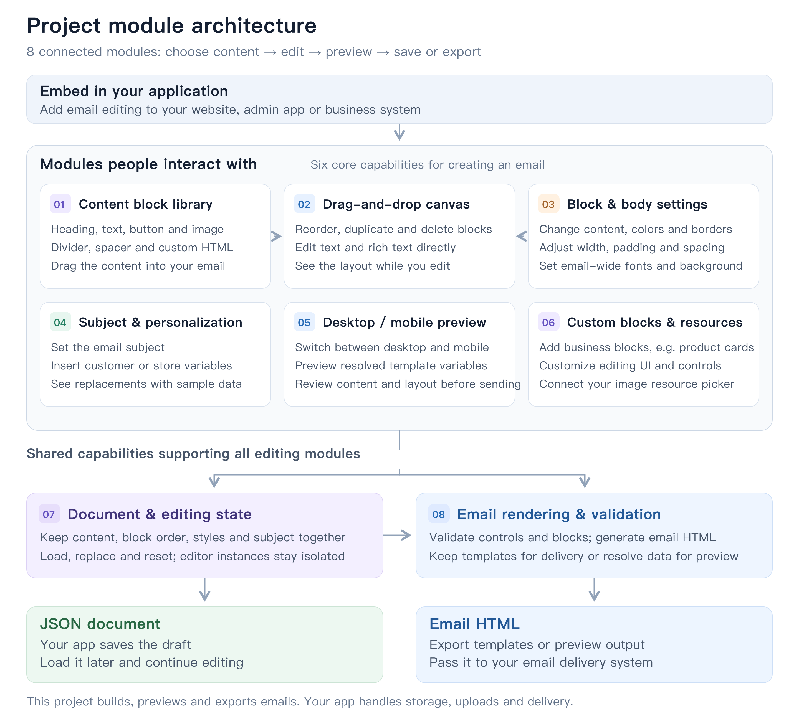

# @standhigher/react-email-editor

English | [简体中文](./README.zh-CN.md)

Drag content onto a canvas, style your email, preview it, then save editable JSON or export email HTML.

## Modules and features



[Open full-size architecture diagram](./docs/assets/architecture.png) · [Editable SVG](./docs/assets/architecture.svg)

## Install and integrate

Requires React 18 and React DOM 18. Ships ESM and TypeScript declarations.

```bash
pnpm add @standhigher/react-email-editor
```

```tsx
import { EmailEditor, useEmailEditor } from "@standhigher/react-email-editor";
import "@standhigher/react-email-editor/styles.css";

export function EmailPage() {
  const editor = useEmailEditor();
  return <EmailEditor editor={editor} height={720} />;
}
```

With Next.js App Router, add `"use client"` to the integration component and import CSS from an allowed global stylesheet entry. Your app implements persistence, resource uploads and email delivery.

## Run locally

Use a supported Node.js LTS release (at least 22.18 for the complete test suite) and pnpm:

```bash
pnpm install --frozen-lockfile
pnpm dev
```

Open [http://localhost:5173](http://localhost:5173); reuse an existing server when available. See [development and local linking](./docs/api.md#development-and-local-linking) for build and validation commands.

## Documentation

- [API reference](./docs/api.md): every public export, parameter, default and type.
- [Basic examples](./docs/basic-examples.md): initial content, saving/loading, body styles, variables and preview.
- [Advanced examples](./docs/advanced-examples.md): validated saving, multiple instances, custom blocks, multiple editing regions, resource adapters and standalone export.
- [Custom block guide](./docs/custom-blocks.md): detailed controls, plugins and rendering helpers.
- [Changelog](./CHANGELOG.md).

The document format is under development. Only `version: 4` is supported, without automatic migration of older documents.
